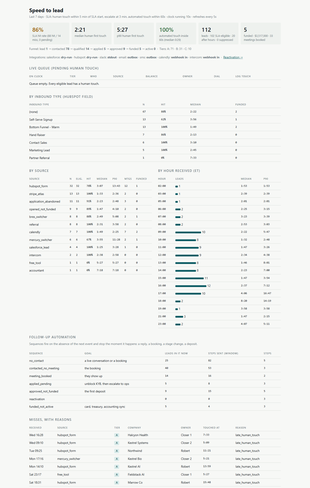
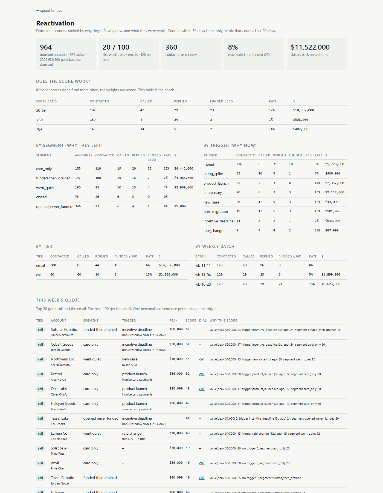

# Speed-to-Lead Router

A working prototype of the system behind a five-minute inbound SLA for a business-banking fintech: every warm lead hits one webhook, gets scored and routed, receives an automated first touch inside 60 seconds, pages a human with a click-to-dial brief, escalates at three minutes, logs a miss at five, and reports all of it on a dashboard built for a Friday readout. A reactivation engine works dormant accounts the same way.

Built September 2026 by Robert Carrington as a portfolio project. "Acme" is a fictional bank. Every lead and account is simulated by `simulate.py`. The Salesforce and HubSpot adapters are dry-run only: they show exactly what would be written and have never been connected to a live CRM.





No dependencies beyond Python 3.10+. SQLite for storage. Slack, email, SMS, and enrichment are stubbed behind one-function seams so real providers drop in without touching the pipeline.

## Run it

```bash
python simulate.py --fresh --backfill 7      # a week of realistic history
S2L_SPEED=10 python run.py                   # server on http://127.0.0.1:8765, clock 10x for demos
python simulate.py --live 6 --auto-touch     # in a second terminal: live leads, simulated rep
```

On Windows PowerShell, set the speed with `$env:S2L_SPEED = "10"` before `python run.py`.

Open http://127.0.0.1:8765. The live queue shows leads on the clock. Click "Log call" to stop a clock by hand. Watch the console for alerts, escalations, and misses. Each automated first touch is written to `outbox/` so you can read exactly what went out.

## The pipeline

```
POST /webhook/<source>
  └ normalize   one adapter per source -> one Lead shape            (s2l/normalize.py)
  └ dedupe      same email in 24h = new signal on the old lead, not a new clock
  └ enrich      30-second hard budget; allowed to fail, not to be late (s2l/enrich.py)
  └ score       additive rubric from config/scoring.json -> tier A/B/C or suppress
  └ route       business hours, SLA start, owner: rep / closer / light (s2l/route.py)
  └ touch one   hand-written template per source, one variable, email + SMS (s2l/touch.py)
  └ alert       Slack (or stdout) one-liner with tel: link and CRM link (s2l/alert.py)
  └ clock       escalate at 3:00, miss at 5:00, stop on human touch  (s2l/sla.py)
```

## Definitions the dashboard uses

- **Touch zero**: the automated email/SMS. Target inside 60 seconds. Should be near 100%.
- **First touch**: a human call, personal email, or SMS logged against the lead. Target inside five minutes of the SLA start. This is the tracked number.
- **SLA start**: receipt time during business hours (9 to 18 ET, weekdays); otherwise the next open. After-hours leads still get touch zero immediately plus a booked callback.
- **Escalation**: untouched at three minutes pages the owner again and a backup.
- **Miss**: untouched at five minutes, or touched late. Logged with a reason and never deleted.
- **Exempt**: suppressed leads and Tier C leads do not carry the five-minute human SLA. They get touch zero and a same-day follow-up.

## Follow-up automation

Sequences in `s2l/followup.py` are keyed on a pipeline state and fire on the absence of the next event. Each stops the moment the event happens (reply, booking, stage change, deposit, opt-out). A background loop checks every 15 seconds (scaled).

| Sequence | Starts from | Goal | Steps |
|---|---|---|---|
| no_contact | a call that went to voicemail, or a Tier C lead with no human touch | a conversation or a booking | email 2h · email 1d · rep task 3d · email 3d · breakup 7d |
| contacted_no_meeting | a reached conversation with no booking | the booking | email 1d · SMS 4d · email 4d |
| meeting_booked | the meeting time | they show up | confirm · SMS reminder 1h before |
| applied_pending | the application timestamp | unblock KYB, then escalate | email 1d · rep task 3d · ops escalation 5d |
| approved_not_funded | the approval timestamp | the first deposit | ACH offer 1h · wire details 3d · rep task 7d · bonus deadline 14d · bonus expires 45d |
| funded_not_active | the first deposit | card, treasury, accounting sync | email 1d · email 5d · rep task 10d |

Endpoints that feed it: `POST /lead/<id>/touch` with `reached: false` for a voicemail, `POST /lead/<id>/reply`, `POST /lead/<id>/optout`, `POST /lead/<id>/stage`.

## Reactivation motion

`s2l/reactivation.py` works dormant accounts the way the inbound engine works leads. Accounts load from `data/accounts.json` (from the product database, a Salesforce Account report, or a Snowflake export). Every account is answered three ways:

1. **Why dormant** → segment: opened never funded · funded then drained · card only · went quiet · closed. Active accounts are excluded.
2. **Why now** → most recent trigger: new raise · Brex migration · incentive deadline · hiring spike · rate change · product launch · anniversary.
3. **What it's worth** → prior peak balance.

Score = value + trigger recency × trigger weight + segment prior. Suppressed: open support ticket, compliance hold, opt-out, contacted in the last 30 days.

Every week `POST /reactivation/run` ranks the book: the top 20 get a call task plus a segment-specific email with one personalized sentence (the trigger); the next 100 get the email; the rest hold. A `reactivation` follow-up sequence runs a call task at day 2, a second email at day 5, and a breakup at day 14, stopping on reply, contact, or deposit. `POST /account/<id>/funded` records the outcome. `/reactivation` shows funded-within-30-days by segment, trigger, tier, batch, and score band, so the weights get checked against what happened. Salesforce write-back: Account fields (segment, score, trigger, last contacted) and an open Task per call.

```bash
python simulate.py --fresh --backfill 7 --accounts 1500 --reactivation-weeks 3
```

## Inbound sources modeled

web form (demo or open account), Stripe Atlas partner event (pre-EIN), Brex switcher landing page, Mercury switcher / comparison page, application abandoned (product event), opened but not funded (product event), referral program, accountant/partner form, chat with sales intent, event lists, inbound phone, free tools (SAFE generator, invoice generator, perks).

Add a source: one function in `normalize.py`, one template in `touch.py`.

## Stack adapters (dry run)

The adapters assume a common fintech stack: Salesforce (CRM), HubSpot (website forms and marketing), Intercom (chat), Calendly (booking), and Slack. The pipeline reads those systems' documented payload shapes and prepares the write-back for Salesforce and HubSpot. It has never been connected to a live CRM. With no credentials set, every write is a dry run recorded as an event on the lead, so the demo shows exactly what would have been written.

### Inbound: point their webhooks at these routes

| System | Route | How to connect |
|---|---|---|
| HubSpot | `POST /webhook/hubspot_form` | Workflow: enrollment trigger = form submission (or Inbound Type is known) → action "Send webhook", include all properties. Reads `inbound_type` (Inbound Type), `leadsource`, `signup_conversion_page`, `salesforce_inclusion`, `utm_*`. |
| Salesforce | `POST /webhook/salesforce_lead` | Either an Outbound Message on Lead (SOAP XML; the route acknowledges it) or a Flow with an HTTP callout (JSON). Field names in `config/fieldmap.json`. |
| Intercom | `POST /webhook/intercom` | Developer Hub → webhook, topics `conversation.user.created` and `conversation.user.replied`. Intent is read from the message body. |
| Calendly | `POST /webhook/calendly` | Webhook subscription on `invitee.created`. A booking becomes a lead with `meeting_at` set, or a meeting on an existing lead. |
| Everything else | `POST /webhook/<source>` | Atlas, product events, partner forms: one adapter each in `normalize.py`. |

For a local demo, expose the server with `ngrok http 8765` and use the ngrok URL in each system.

### Outbound: what gets written where

| Event | Salesforce | HubSpot |
|---|---|---|
| Lead created | upsert Lead by Id or Email: score, tier, SLA result, Inbound Type, auto-touch time | upsert contact by id or email: `s2l_*` properties |
| Human touch logged | completed Task on the Lead (Call or Email, with connected / no-answer) and first-touch time + seconds on the Lead | first-touch properties |
| Stage or meeting | Lead fields; Task "meeting booked" | properties |

Field names live in `config/fieldmap.json`. The Salesforce custom fields (`S2L_*__c`) and HubSpot properties (`s2l_*`) are the ones this tool would add; `hubspot.ensure_properties()` creates the HubSpot ones. Rename to whatever RevOps prefers.

Credentials go in environment variables; see `.env.example`. `GET /api/integrations` reports which systems are live.

### Other seams

| Seam | Stub | Real |
|---|---|---|
| `enrich._lookup` | deterministic mock | Clay / Apollo / Clearbit HTTP call, same 30s budget |
| `deliver.send_email` / `send_sms` | writes `outbox/*.txt` | SMTP and Twilio are built in; swap for a sequencer (Outreach, Salesloft) if the team has one |
| `alert.send` | stdout, or Slack if `SLACK_WEBHOOK_URL` is set | already real for Slack |
| `route.assign` | config round-robin | Salesforce assignment rules or Chili Piper |

## Weekly readout

`GET /api/metrics` returns hit rate, median and p90 human first touch, automated-touch compliance, by-source and by-hour breakdowns, the miss list with reasons, funnel counts, meetings, and funded dollars for the last seven days. That is the Friday report.
